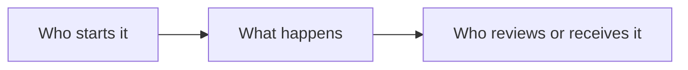

<!--
HOW TO USE THIS TEMPLATE
1. Copy this folder, rename it after the project (e.g. grillos/), and delete these notes.
2. Write what the business needed, not only what you coded. Plain words, few numbers,
   and only claims you can back up.
3. Keep client and employer names out unless you have permission. Describe the client by type
   and industry ("a food-truck business", "a building-materials distributor").
4. Screenshots: use fake or blurred data. Put images in ./images and reference them below.
5. Check your contract or NDA before publishing anything. If unsure, ask, or leave the project out.
-->

# Project name

> One sentence: what it is and who it is for.

**Status:** Live / Completed / In development / Prototype &nbsp;·&nbsp; **Year:** 20XX &nbsp;·&nbsp; **Role:** e.g. Business analysis → build
**Live link:** [add link if public](https://example.com) &nbsp;·&nbsp; **Source code:** private (client work)

## The problem

What was slow, manual or unreliable, and what it cost. Two or three sentences.

## The solution

What was built, in plain words. Two or three sentences, then the key features:

- Feature or workflow one
- Feature or workflow two
- Feature or workflow three

## How it works

## My contribution

What I did, specifically: analysis, process and data design, build, testing, rollout.

## Result

Only what is true and can be backed up. Prefer "agents see their own statements" over an invented percentage.

## Built with

`Tool` · `Tool` · `Tool`
