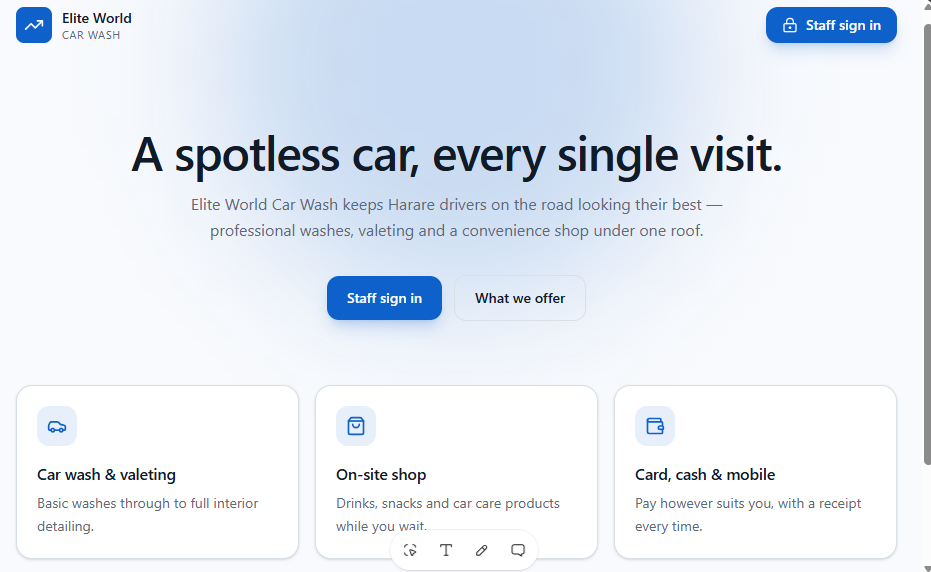

# Car Wash OS

> Service and operations site for a Harare car wash: packages, valeting, on-site shop and staff sign-in.

**Status:** Completed &nbsp;·&nbsp; **Years:** 2025 &nbsp;·&nbsp; **Role:** Business analysis → build
**Domain:** Operations website &nbsp;·&nbsp; **Source code:** private (client work)

## The problem

A growing car wash tracked services, shop sales and staff across paper and chat, with unclear pricing, no central record and end-of-day reconciliation by hand.

## The solution

A customer-facing and staff operations site bringing service packages, the shop, payments and authenticated staff sign-in into one platform.

## My contribution

Business analysis, workflow design, and build of the operations platform.

## Result

- Clear service packages and pricing
- A central daily operations record
- Secure staff access

## Built with

`React` · `TanStack Start` · `Authentication`
