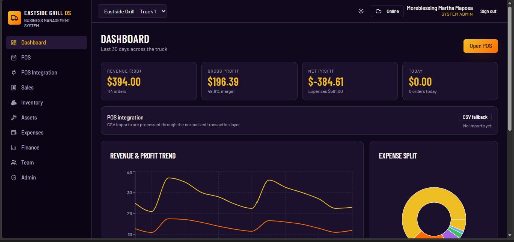

# GrillOS

> Point of sale and operations system for a food-truck business: inventory, recipe costing, finance and payroll.

**Status:** Completed &nbsp;·&nbsp; **Years:** 2025–2026 &nbsp;·&nbsp; **Role:** Business analysis → build
**Domain:** POS & business system &nbsp;·&nbsp; **Source code:** private (client work)

## The problem

A food truck ran inventory, finance, payroll and assets across paper and spreadsheets, which was hard to reconcile at truck pace and gave no clear view of profitability.

## The solution

An operations and POS system with offline-first sales, role-based access, recipe-driven cost of goods and finance reports.

## My contribution

Business analysis, operations design, and build of the POS and business system.

## Result

- Cashier, manager and admin roles
- Recipe-driven cost of goods
- Finance reports and multi-truck readiness

## Built with

`React` · `TypeScript` · `Supabase` · `Offline-first`
