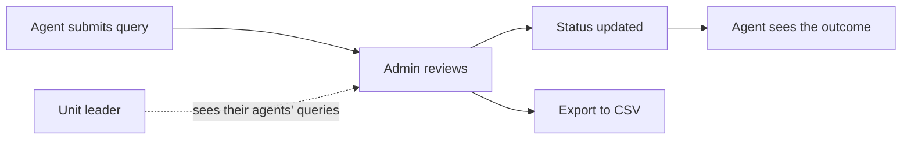

# Query Hub

> A commission query platform for insurance agents and administrators: submissions, statements, rates and enquiry tracking in one place.

**Status:** Live &nbsp;·&nbsp; **Years:** 2025–2026 &nbsp;·&nbsp; **Role:** Business analysis → build
**Live link:** [query-hub-portal.vercel.app](https://query-hub-portal.vercel.app) &nbsp;·&nbsp; **Source code:** private (workplace system)

## The problem

Insurance agents' commission questions were handled by phone, email and spreadsheets, with no single place to track an enquiry from question to answer.

## The solution

A platform where agents submit and track their commission queries in USD and ZWG, and administrators review them, update their status and export to CSV. Unit leaders can see their own agents.

- Agents see product rates and their monthly statements themselves
- Admins and unit leaders see the status of every query without chasing email
- Role-based access, so each person sees only what they should
- A no-server Google Forms + Apps Script edition, built for workplace rollout

## How it works

## My contribution

Business analysis, data and role design, and the build of the platform, including the Google Forms + Apps Script edition.

## Result

Every commission query is captured and tracked in one place. Agents can look up rates and statements themselves, and admins no longer have to chase status over email.

## Built with

`React` · `TypeScript` · `Supabase` · `Role-based access` · `Google Apps Script` · `Vercel`
